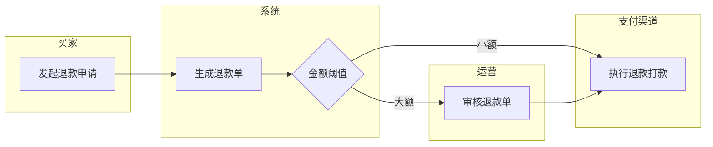

# intent.md — 需求入口物料模板（SDD 流程最前端）

**位置**: `specs/NNN-<slug>/intent.md`。置于**整个流程最前端**——在 `/speckit-constitution`（项目首建）与 `/speckit-specify`（后续 feature）之前编写。
**性质**: 业务方原始需求的入口记录，用业务语言，允许粗糙、允许口语——不套 spec 格式纪律。
**GI 门禁（两段，通过后才允许进入下一流程）**:
① **基础内容**：§1–§4 四段齐备非空（需求说明/需求痛点/需求草稿/泳道图）；
② **对抗拷问**：发现 ① 已有基本内容后，MUST 用 `grill-with-docs` 套件（上游 mattpocock/skills 的 `grilling`＋`domain-modeling`，本包已 vendored；Hermes 单代理执行可用等价强化体 `grill-me`）按设计树逐轮拷问需求，直到 frontier 清空——每个分支都有结论、无静默假设；拷问结论（决定/砍掉项/ADR/术语表）回写 §5，仓库级 GLOSSARY.md / docs/adr/ 按 domain-modeling 的格式另立。
**冻结规则**: spec 定稿后本文件冻结为溯源快照；此后需求变化走回写三分类、直接改 spec，**不回改 intent.md**；新迭代另起一份新 intent.md。

---

## 0. 元信息

| 项 | 内容 |
|---|---|
| feature 编号/目录 | `specs/NNN-<slug>/` |
| 需求提出人 / 日期 | `<待填>` |
| 目标用户 | `<待填：谁在什么场景用它>` |
| 关联总纲模块 | `<待填>` |
| GI 状态 | ☐ 基础内容齐 ☐ 拷问完成（frontier 清空） |

## 1. 需求说明

- **一句话目标**：`<待填：给谁解决什么，达到什么效果>`
- **背景场景**：`<待填：触发这个需求的真实业务场景，2–3 行>`
- **期望效果**：`<待填：上线后怎么算成功，尽量给数字——落点为 spec 的 SC>`

## 2. 需求痛点（现状与代价）

| 痛点 | 现状是怎样的 | 代价 / 频率 | 风险 |
|---|---|---|---|
| `<待填>` | `<例：退款靠人工翻聊天记录核对>` | `<例：每单 20 分钟，日均 30 单>` | `<例：核对错漏→资损，月均 2 起>` |

> 写法：一行一个痛点，只写事实与数字，不写方案。痛点段 = spec Success Criteria 的动机来源。

## 3. 需求草稿（原始素材，非定稿）

- 功能点草表（想到什么记什么，标注优先级直觉）：

| # | 功能点草稿 | 直觉优先级 |
|---|---|---|
| 1 | `<例：买家发起退款自动生成退款单>` | P1 |
| 2 | `<例：小额免人工审核>` | P2 |

- 界面草图 / 对话记录片段 / 邮件或 Excel 摘录 / 竞品截图说明：`<待填，可贴图或贴原文>`

> 草稿段允许被推翻；进入 spec 的每条 FR 应能回查到这里或 §1/§4 的出处。

## 4. 泳道图（角色 × 流程）

泳道 = 参与方各一条（客户 / 操作员 / 系统 / 第三方）；节点写动作，箭头写流转；分支标条件。用 mermaid（flowchart + subgraph 模拟泳道），复杂流程可贴绘图工具导出图。

> 泳道图落点：spec 的 User Story 流程主线 + Edge Cases（异常分支、中断点、超时）。画不出泳道的需求＝还没想清楚，先补齐再进拷问。

## 5. 拷问记录（grill-with-docs，GI 门禁第二段）

拷问机制：把需求建模为设计树，每轮只问「前置已定」的 frontier 问题，逐题附推荐答案；回答重塑树、推前沿，直到无开放分支。本段承接 `grill-with-docs` 的 docs 产出面：`grilling` 管轮次与 frontier，`domain-modeling` 管术语表（GLOSSARY，格式见其 GLOSSARY-FORMAT.md）与 ADR（格式见其 ADR-FORMAT.md）；intent.md 记 feature 级，仓库级 GLOSSARY.md/docs/adr/ 由其 lazily 创建。

### 5.1 轮次日志

| 轮 | 问题（含推荐答案） | Owner 结论 | 状态 |
|---|---|---|---|
| 1 | `<例：Q1 小额阈值定多少？推荐 ¥200，依据日均单量与资损率>` | `<待填>` | ☐ |

### 5.2 决定记录（ADR 式）

- **ADR-01**: `<决定>` — 背景/取舍/影响一句话（被砍掉的草稿项也记这里，注明砍因）。

### 5.3 术语表

| 术语 | 定义 | 是否进 Key Entities |
|---|---|---|
| `<例：退款单>` | `<一句话业务定义>` | `<是/否>` |

> 术语表是 Key Entities 的前置喂料：拷问中定名的业务概念，进 spec 时按实体/属性术语纪律逐个确认落 Key Entities。

## 6. 对 spec 的映射（写 spec 时对照）

| intent 段 | spec 落点 |
|---|---|
| §1 需求说明 | User Scenarios（US 旅程主线）、Assumptions |
| §2 需求痛点 | Success Criteria（SC-xxx，可测数字） |
| §3 需求草稿 | FR 候选清单（逐条转写为 MUST；砍掉的在 Assumptions/ADR 记原因） |
| §4 泳道图 | US 验收场景 + Edge Cases（每个分支/异常一条） |
| §5 拷问记录 | 开放问题清零证据 + 术语表 → Key Entities 确认清单 |

**边界提醒**：intent.md 里可以出现口语化的「点一个创建按钮弹个窗」；但转写进 spec 时必须剥离控件措辞，只留 WHAT（如「操作人 MUST 二次确认后提交」），形态归 DESIGN.md §11 + 原型（见落位规则）。
